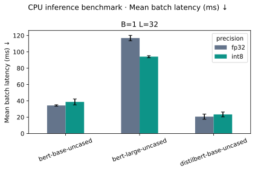

# Model Optimization Benchmark

**Does INT8 actually help your inference workload? Measure it.**

A reproducible performance-engineering project comparing **DistilBERT, BERT Base, and BERT Large** under FP32 and dynamic INT8 CPU inference. It measures latency distributions, throughput, process memory, serialized model state, and prediction-quality changes without assuming quantization is always beneficial.

This is a benchmark of encoder masked-language models, not a generative chatbot benchmark. Runs on Apple silicon measure the **CPU**, not the GPU or Neural Engine.

## What this demonstrates

- Controlled experiments with fixed input shapes, thread counts, warmups, and independent processes.
- Model integration and dynamic INT8 conversion with explicit backend validation.
- Performance analysis that separates storage, runtime memory, speed, and quality.
- Reproducibility through checkpoint SHA pinning, resolved configs, raw timings, and environment manifests.
- Failure-aware reporting: failed cells are preserved and excluded from numerical comparisons.

## Results

See [measured findings](results/published/findings.md), [raw CSV](results/published/benchmark_results.csv), and [environment manifest](results/published/manifest.json).

| Model | FP32 mean latency | INT8 mean latency | INT8 / FP32 throughput | State reduction |
| --- | ---: | ---: | ---: | ---: |
| distilbert-base-uncased | 20.62 ms | 23.35 ms | 0.88× | 39.4% |
| bert-base-uncased | 34.37 ms | 38.70 ms | 0.89× | 53.2% |
| bert-large-uncased | 116.92 ms | 94.12 ms | 1.24× | 65.5% |

Measured on Apple M1 CPU, four threads, batch 1, sequence length 32, three process trials with 30 timed forwards each. Variability, quality changes and memory measurements are in the linked findings and raw data.



The published run is an exploratory batch-1, sequence-length-32 comparison with three trials per model/precision. It is not the full workload matrix and does not establish general production performance. The 24-sentence quality probe is diagnostic, not a validated accuracy benchmark.

Download [dashboard.html](results/published/dashboard.html) and open it in a browser for interactive charts and trial-level data. The published HTML loads Plotly from its CDN; SVG charts work offline. Locally generated reports are self-contained.

## Run it

Tested with Python 3.14 on macOS arm64. Linux CPU smoke testing is configured in GitHub Actions; inspect the workflow status rather than assuming it passed. A recent CPU PyTorch build with a dynamic quantization backend is required. Windows is not supported by the POSIX memory instrumentation.

```bash
git clone https://github.com/Skeeb32/ml-model-optimization-benchmark.git
cd ml-model-optimization-benchmark
python3.14 -m venv .venv
source .venv/bin/activate
pip install -r requirements.txt
pip install --no-deps .

# Offline plumbing check: tiny, random model, no pretrained quality claims.
mlbench run --smoke --output results/smoke

# Reproduce the compact published experiment (downloads pretrained weights).
mlbench run --config config/portfolio.yaml --output results/my-portfolio-run

# Full matrix: three models, two precisions, batch 1/8, length 32/128, three trials.
mlbench run --config config/benchmark_config.yaml --output results/full-matrix

# Regenerate charts and findings from an existing run.
mlbench report results/my-portfolio-run
pytest -q
```

Output paths must be new: previous experiments are never silently overwritten. First runs download several GB of model weights into the Hugging Face cache. BERT Large and its conversion can require several GB of RAM. Each cell has a configurable timeout (`--timeout 1800`). If Hugging Face Xet downloads fail on your network, retry a **new** run with `HF_HUB_DISABLE_XET=1`; preserve the failed run for diagnosis.

For an exact checkpoint rerun, use a copy of the published `resolved_config.yaml` in `config/` rather than floating `main` revisions. The CLI resolves all revisions before running. `requirements.txt` records the tested environment; `pyproject.toml` defines broader install compatibility, which is not a promise of identical results.

## Architecture


```text
config/              Full matrix and compact portfolio experiment
data/                Original diagnostic sentences
src/mlbench/         CLI, models, inference, quantization, metrics, worker, report
tests/               Metric, pairing, validation and real INT8 inference tests
results/published/   Measured artifacts, raw timings and provenance
docs/                Measurement contract and optimization interpretation
notebooks/           Reusable analysis of measured CSV data
.github/workflows/   Tests and download-free smoke benchmark
```

## Read the metrics correctly

| Metric | Meaning | Important limitation |
| --- | --- | --- |
| Mean, p50, p95, p99 latency | Time per batch forward pass | Excludes tokenization, loading and networking |
| Samples/second | Total samples / total measured forward time | Single-worker offline throughput |
| Sampled peak RSS | Total process resident memory in a separate inference pass | Includes runtime and retained allocations; can miss brief peaks |
| Process high-water RSS | Peak through load, conversion and inference | Not inference-only memory |
| Serialized state MiB | Actual saved state dictionary size | Not runtime RAM or a Core ML artifact |
| Masked-token accuracy / NLL | Predictions on original diagnostic sentences | Small, nonrepresentative corpus |
| FP32 prediction agreement | INT8 predictions matching paired FP32 | Agreement is not ground-truth accuracy |

Read the full [measurement contract](docs/methodology.md) and [optimization decision framework](docs/optimization_findings.md) before interpreting a speedup.

## Engineering decisions

**Why the same task?** All three models use pretrained masked-language-model heads. Attaching an untrained classifier would make an accuracy comparison misleading.

**Why CPU only?** Dynamic INT8 CPU operators and GPU/Neural Engine execution have different kernels and instrumentation requirements. Mixing them would confound precision with hardware. Core ML and MLX deserve separately validated experiments.

**Why keep FP32 layers?** Dynamic quantization converts Linear layers; embeddings and layer normalization remain floating point. The reported converted-layer count prevents presenting partial conversion as an entirely INT8 model.

**Why a legacy quantization API?** `torch.ao.quantization.quantize_dynamic` is a clear reference baseline, but deprecated. The tested versions are pinned. Migrating to torchao is a future, separately named backend with parity tests, not an undocumented replacement.

## Next experiments

- Larger, licensed evaluation corpus and confidence intervals over independent examples.
- torchao backend with conversion and numerical parity checks.
- More batch sizes, sequence lengths, thread counts and repeated sessions.
- Separate Core ML / MLX implementations with device-specific synchronization and profiling.
- Energy measurement using suitable device instrumentation; no battery savings are claimed here.

## References and licensing

- [PyTorch dynamic quantization API](https://docs.pytorch.org/docs/stable/generated/torch.ao.quantization.quantize_dynamic.html)
- [PyTorch quantization migration](https://github.com/pytorch/ao)
- [Hugging Face BERT documentation](https://huggingface.co/docs/transformers/model_doc/bert)
- [DistilBERT model card](https://huggingface.co/distilbert/distilbert-base-uncased)
- [BERT Base model card](https://huggingface.co/google-bert/bert-base-uncased)
- [BERT Large model card](https://huggingface.co/google-bert/bert-large-uncased)

Code and original diagnostic sentences: MIT. Downloaded model weights retain their upstream licenses and are not committed. No illustrative numbers are mixed with measured results.
