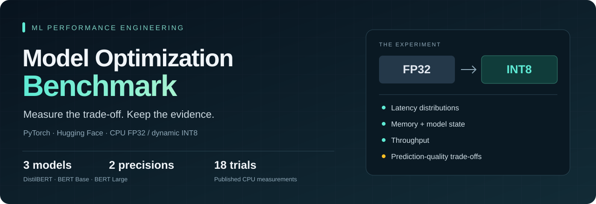
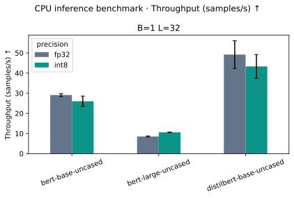
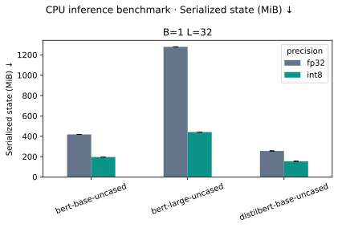
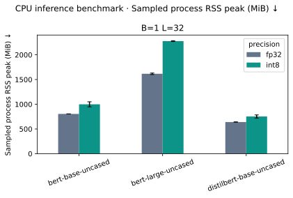
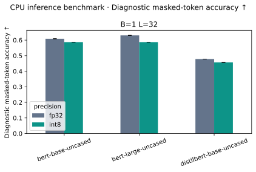
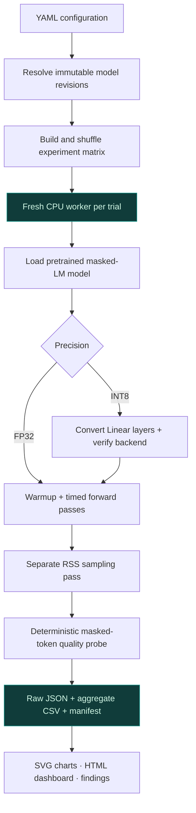

<p align="center">
  
</p>

<h1 align="center">Measure before you optimize.</h1>

<p align="center">
  <strong>A reproducible lab for understanding what quantization actually changes.</strong><br>
  Compare DistilBERT, BERT Base, and BERT Large across speed, memory, model size, and prediction quality.
</p>

<p align="center">
  <a href="https://github.com/Skeeb32/ml-model-optimization-benchmark/actions/workflows/ci.yml"></a>
  <a href="pyproject.toml"></a>
  <a href="src/mlbench/quantization.py"></a>
  <a href="LICENSE"></a>
</p>
<p align="center">
  <a href="https://github.com/Skeeb32/ml-model-optimization-benchmark/stargazers"></a>
  <a href="https://github.com/Skeeb32/ml-model-optimization-benchmark/forks"></a>
  <a href="https://github.com/Skeeb32/ml-model-optimization-benchmark/commits/main"></a>
</p>

<p align="center">
  <a href="#the-results">Measured results</a> ·
  <a href="#quick-start">Quick start</a> ·
  <a href="docs/methodology.md">Methodology</a> ·
  <a href="#an-engineering-tour">Engineering tour</a> ·
  <a href="#contribute-an-experiment">Contribute</a>
</p>

---

## Smaller files. Sometimes slower inference.

INT8 sounds like an obvious upgrade: smaller weights, less memory, faster predictions. Real workloads are less predictable. Kernel support, matrix shapes, thread counts, and the parts of a model that remain floating point all influence the outcome.

This project turns that uncertainty into a repeatable experiment. Every comparison produces **raw timings, a resolved configuration, an environment manifest, and inspectable results**. Speedups and slowdowns receive the same treatment.

> **The finding that matters:** in the published Apple M1 CPU run, INT8 reduced serialized model state for all three models. BERT Large became faster; BERT Base and DistilBERT became slower. All three changed predictions on the small diagnostic quality probe.

**Scope:** pretrained encoder models performing masked language modeling on CPU. These measurements do not describe chat generation, Apple GPU, Neural Engine, Core ML, or MLX performance.

## The results

**18 completed experiment cells · 3 models · 2 precisions · 3 independent process trials**


| Model | FP32 mean latency ↓ | INT8 mean latency ↓ | Smaller serialized state | Diagnostic accuracy change |
| :--- | ---: | ---: | ---: | ---: |
| **DistilBERT** | 20.62 ms | 23.35 ms | 39.4% | −2.17 pp |
| **BERT Base** | 34.37 ms | 38.70 ms | 53.2% | −2.17 pp |
| **BERT Large** | 116.92 ms | 94.12 ms | 65.5% | −4.35 pp |

<details>
<summary><strong>Read the experiment conditions before comparing these numbers</strong></summary>

- **Hardware:** Apple M1 CPU, 16 GiB system RAM; four intra-op threads, one inter-op thread.
- **Workload:** batch size 1, sequence length 32, synthetic token IDs; pretrained masked-LM heads.
- **Sampling:** five warmup forwards, then 30 timed forwards per trial; three trials per model/precision. Chart error bars show sample standard deviation across trials.
- **Timing boundary:** completed CPU forward passes, including logits. Excludes tokenization, loading, downloads, conversion, and memory polling.
- **Quality:** 24 original sentences and 46 masked tokens. “pp” means percentage points. This is a diagnostic probe, not a representative accuracy benchmark; repeated trials do not add new evaluation examples.
- **Limits:** exploratory workstation measurements; thermal state, power mode, and background workloads were not controlled. The broader workload matrix has not been published as measured results.

[Environment and model revisions](results/published/manifest.json) · [Run notes](results/published/RUN_NOTES.md) · [Full measurement contract](docs/methodology.md)

</details>

### Explore the evidence

| Start here | What you can inspect |
| :--- | :--- |
| [Measured findings](results/published/findings.md) | Paired speedups, state-size reductions, quality changes, and interpretation |
| [Interactive dashboard](results/published/dashboard.html) | Download the HTML and open it locally for interactive charts and trial-level data |
| [Results CSV](results/published/benchmark_results.csv) | Every successful trial, with latency percentiles, throughput, memory, and quality |
| [Raw worker results](results/published/raw) | Individual timing samples, predictions, converted-layer counts, and logs |
| [Analysis notebook](notebooks/performance_analysis.ipynb) | Reusable aggregation and visualization of the measured CSV |

The published dashboard loads Plotly from its CDN and needs internet access. Reports generated locally embed Plotly; the SVG plots also work offline. GitHub displays HTML source rather than hosting a live dashboard.

<details>
<summary><strong>More charts: throughput, model state, runtime memory, and quality</strong></summary>

### Throughput



### Serialized model state



### Runtime process memory



### Diagnostic prediction quality



Storage savings and process-memory savings are different measurements. RSS includes the runtime, inputs, outputs, and retained allocator pages; it is not model-only memory.

</details>

## Built for evidence

| Capability | What the implementation does |
| :--- | :--- |
| **Controlled comparisons** | Uses the same pretrained task head type, input dimensions, seed, and thread settings across precisions |
| **Isolated trials** | Launches a fresh subprocess per cell and shuffles experiment order with a fixed seed |
| **Verified quantization** | Records the CPU backend and converted Linear-layer count; fails when no layers convert |
| **Separate measurement passes** | Keeps memory polling out of the timed forward loop |
| **Quality alongside speed** | Reports masked-token accuracy, negative log likelihood, and paired FP32 prediction agreement |
| **Traceable outputs** | Saves checkpoint SHAs, package versions, corpus hashes, raw samples, and resolved YAML |
| **Visible failures** | Preserves failed cells and logs, excludes them from performance charts, and exits unsuccessfully |
| **Automated checks** | Runs lint, tests, and a download-free smoke experiment in GitHub Actions |

## Under the hood



**Inference:** Python · PyTorch · Hugging Face Transformers / Hub  
**Measurement:** NumPy · psutil · POSIX resource accounting  
**Analysis:** pandas · Matplotlib · Plotly  
**Configuration and quality:** YAML · pytest · Ruff · GitHub Actions

<details>
<summary><strong>Four engineering decisions worth understanding</strong></summary>

**1. Keep the task comparable.** Each checkpoint uses its pretrained masked-language-model head. An untrained classification head would produce misleading quality comparisons. Model size comparisons still involve different architectures and pretraining, so they are not controlled parameter-count experiments.

**2. Name the precision honestly.** Dynamic INT8 converts supported Linear layers. Embeddings, layer normalization, and other operators remain floating point. The suite records the conversion count rather than calling the entire model INT8.

**3. Separate memory questions.** Saved state bytes, sampled inference RSS, and process high-water RSS answer different questions. A new process prevents cross-model allocator reuse, but FP32 loading and conversion can still leave retained pages within a worker.

**4. Make backend changes explicit.** The current reference implementation uses deprecated `torch.ao.quantization.quantize_dynamic`. Tested dependencies are pinned. A torchao migration needs its own parity checks and experiment identity; it is on the roadmap.

</details>

## Quick start

### 1. Prepare your environment

Use **Python 3.14** for the pinned environment. The code declares Python 3.11+ compatibility, but the pinned dependencies and CI target 3.14. Local measurements were verified on macOS arm64; Ubuntu CI verifies lint, tests, and smoke execution.

You need Git, a CPU PyTorch build with a supported dynamic quantization backend, and sufficient RAM for model loading and conversion. The published run used a 16 GiB Mac. Pretrained weights require several GB of download/cache space. Native Windows is not supported by the POSIX memory instrumentation.

```bash
git clone https://github.com/Skeeb32/ml-model-optimization-benchmark.git
cd ml-model-optimization-benchmark

python3.14 -m venv .venv
source .venv/bin/activate
python -m pip install -r requirements.txt
python -m pip install --no-deps .
```

No `.env` file, cloud service, or API key is required. Public model downloads use Hugging Face; smoke mode needs no model downloads after dependencies are installed.

### 2. Verify the pipeline without downloading models

```bash
mlbench run --smoke --output results/my-smoke
```

This exercises a tiny BERT with **random weights**. It verifies execution, conversion, CSV generation, and reporting; it is not a pretrained performance or quality result.

### 3. Run the published experiment configuration

```bash
# Use the exact checkpoint revisions recorded in the published run.
cp results/published/resolved_config.yaml config/reproduce.yaml
mlbench run --config config/reproduce.yaml --output results/my-reproduction
```

Expect comparable methodology, not identical timings across hardware or machine conditions. Always use a **new output directory**; the CLI refuses to overwrite an existing run.

### 4. Explore the output

```text
results/my-reproduction/
├── benchmark_results.csv     # Trial-level metrics and paired comparisons
├── manifest.json             # Environment, versions, revisions and run status
├── resolved_config.yaml      # Effective experiment settings
├── quality_corpus.txt        # Exact diagnostic text used
├── raw/                      # Per-cell JSON, individual timings and worker logs
├── plots/                    # Shareable SVG figures
├── dashboard.html            # Interactive, locally generated report
└── findings.md               # Measured comparisons and interpretation
```

Open `results/my-reproduction/dashboard.html` in a browser. No application server or deployment is required.

```bash
# Rebuild the report from an existing result directory.
mlbench report results/my-reproduction
```

## Design your own experiment

Keep custom YAML files in `config/` so the relative corpus path resolves correctly. Start by copying [portfolio.yaml](config/portfolio.yaml), then adjust its existing fields:

```yaml
seed: 42
threads: 4
warmup: 10
iterations: 50
trials: 3
batch_sizes: [1, 8]
sequence_lengths: [32, 128]
precisions: [fp32, int8]
engine: auto
```

Retain the `models` and `quality_corpus` entries from the original file. Model revisions set to `main` are resolved to immutable SHAs at the start of a run. `engine: auto` selects an available backend from `x86`, `fbgemm`, and `qnnpack`.

```bash
# The configured full matrix contains 72 experiment cells.
mlbench run --config config/benchmark_config.yaml --output results/full-matrix

# Allow a longer timeout for each individual worker.
mlbench run --config config/portfolio.yaml --output results/long-timeout --timeout 3600
```

The full matrix is available to run; only the compact 18-cell experiment is published here. Larger shapes may materially increase runtime and memory use. Tail-latency claims need more samples than the exploratory defaults.

<details>
<summary><strong>Troubleshooting and optional notebook setup</strong></summary>

| Symptom | Next step |
| :--- | :--- |
| Output directory already exists | Choose a new directory; keep prior measurements intact |
| Hugging Face Xet download failure | Retry a new run with `HF_HUB_DISABLE_XET=1` before the command |
| Unsupported INT8 engine | Inspect the worker log and use a CPU PyTorch build with a supported backend |
| Worker fails or times out | Read `raw/cell-*.log`; reduce workload dimensions or increase `--timeout` |
| Changes to source are not reflected | Reinstall with `python -m pip install --no-deps .`, or use editable development setup below |

For interactive notebook analysis, install JupyterLab separately:

```bash
python -m pip install jupyterlab
jupyter lab notebooks/performance_analysis.ipynb
```

JupyterLab is optional and is not part of the pinned benchmark environment. For stricter environment reproducibility, analyze exported results in a separate environment.

</details>

## An engineering tour

**Reviewing this as an engineer or hiring manager?** These are the implementation decisions and evidence to inspect:

| Engineering skill | Code and evidence |
| :--- | :--- |
| **Experiment design** | [CLI orchestration](src/mlbench/cli.py): seeded trial order, revision resolution, isolated workers, and failure handling |
| **ML systems integration** | [Model loading](src/mlbench/models.py) and [quantization](src/mlbench/quantization.py): shared task, CPU backend selection, verified conversion |
| **Performance instrumentation** | [Worker](src/mlbench/worker.py) and [metrics](src/mlbench/metrics.py): separate timing/memory passes, explicit units, throughput aggregation |
| **Evaluation discipline** | [Inference and quality probe](src/mlbench/inference.py): deterministic masking, loss, accuracy, input hashes, and prediction agreement |
| **Data communication** | [Report generation](src/mlbench/report.py): trial variability, interactive charts, and findings backed by raw artifacts |
| **Engineering quality** | [14 collected tests](tests), [CI workflow](.github/workflows/ci.yml), and [measurement contract](docs/methodology.md) |

The project demonstrates ML inference integration, performance profiling, reproducibility, and technical communication. Its measurements are CPU experiments, not evidence of production-scale serving or Apple-specific inference framework implementation.

## Project health

The badges above show live CI, stars, forks, and commit activity. Source package version **0.1.0** is defined in [pyproject.toml](pyproject.toml); this is not a claim of a published package release.

- **Published evidence:** 18 successful experiment cells, raw samples, six metric charts, and a runnable analysis notebook.
- **Automation:** lint → tests → offline smoke benchmark → uploaded smoke artifacts, on pushes and pull requests.
- **Coverage:** no coverage percentage is published; inspect the test cases directly.
- **Maintainer:** [Shaqib Habib](https://github.com/Skeeb32). Contributions and reproducible findings are welcome.

## Roadmap

**Implemented**

- [x] DistilBERT / BERT Base / BERT Large with pretrained masked-LM heads
- [x] FP32 and verified dynamic INT8 CPU execution
- [x] Isolated trials, raw metrics, revision pinning, and manifests
- [x] Diagnostic quality checks and paired prediction comparisons
- [x] CSV, SVG, interactive HTML, findings, and notebook analysis
- [x] Published 18-cell experiment and automated smoke testing

**Proposed next experiments — contributions welcome**

- [ ] Representative, licensed evaluation corpus and quality confidence intervals
- [ ] torchao backend with numerical parity and conversion tests
- [ ] Published batch-size, sequence-length, and thread-count sweeps
- [ ] Separate Core ML / MLX experiments with backend-specific instrumentation
- [ ] Energy measurements using suitable device tooling

These are planned directions, not claims of active implementation or shipped capabilities.

## Contribute an experiment

A useful contribution can be a better measurement method, an evaluation dataset, a backend implementation, or a carefully documented finding that an optimization **doesn't** help.

1. [Open an issue](https://github.com/Skeeb32/ml-model-optimization-benchmark/issues/new) describing the question, workload, and proposed change.
2. Fork the repository and create a focused branch.
3. Use editable installation for development:

   ```bash
   python -m pip install --no-deps -e .
   ruff check src tests
   pytest -q
   mlbench run --smoke --output results/pr-smoke
   ```

4. Include tests and update the methodology when measurement semantics change.
5. Open a pull request with reproduction steps, hardware/runtime details, and raw evidence for any performance claim.

Keep model weights, caches, secrets, and fabricated results out of commits. See [CONTRIBUTING.md](CONTRIBUTING.md) for the contribution contract.

## References and license

[PyTorch dynamic quantization](https://docs.pytorch.org/docs/stable/generated/torch.ao.quantization.quantize_dynamic.html) ·
[torchao](https://github.com/pytorch/ao) ·
[Hugging Face BERT](https://huggingface.co/docs/transformers/model_doc/bert)

Model cards: [DistilBERT](https://huggingface.co/distilbert/distilbert-base-uncased) · [BERT Base](https://huggingface.co/google-bert/bert-base-uncased) · [BERT Large](https://huggingface.co/google-bert/bert-large-uncased)

Code and original diagnostic sentences are [MIT licensed](LICENSE). Downloaded model weights retain their upstream licenses and are not committed.

---

<p align="center">
  <strong>Make the next optimization decision with evidence.</strong><br><br>
  ⭐ Star it to keep the benchmark handy · Fork it to test your workload · Share a reproducible finding<br><br>
  <a href="https://github.com/Skeeb32/ml-model-optimization-benchmark/issues">Report an issue</a> ·
  <a href="https://github.com/Skeeb32/ml-model-optimization-benchmark/pulls">Contribute a change</a> ·
  <a href="#quick-start">Run your first experiment</a>
</p>
